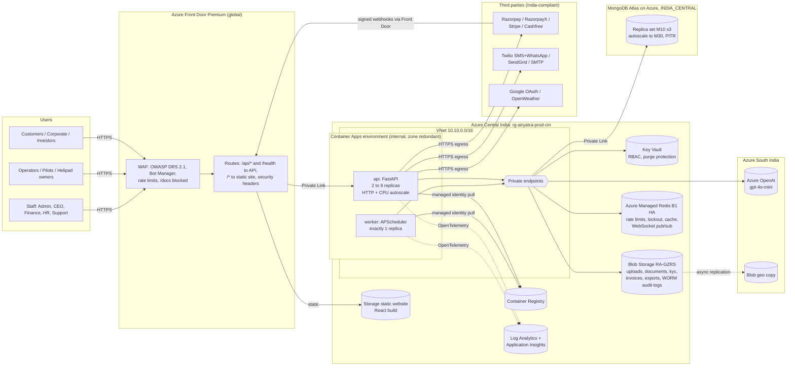
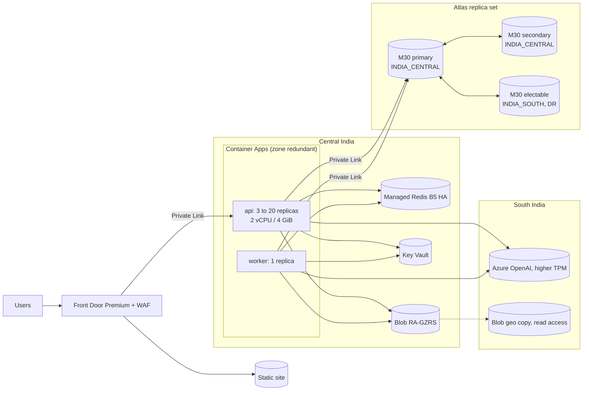

# Phase 1: Target Azure Architecture

Spec: [`docs/AirYatra_Refurbish_Master_Prompt.md`](../AirYatra_Refurbish_Master_Prompt.md), Phase 1 and Sections Q, E, S.
Infrastructure as code: [`infra/terraform/`](../../infra/terraform/README.md).
Sequence diagrams: [high level](02-sequence-diagrams-high-level.md), [low level](03-sequence-diagrams-low-level.md).
Threat model: [04-threat-model.md](04-threat-model.md).

## 1. Executive summary

1. AirYatra moves to Azure Central India: the website is served from Azure Front Door, the API runs as containers on Azure Container Apps, and the database stays MongoDB (MongoDB Atlas, hosted on Azure in India), so not a single stored value changes.
2. Every data service (database, Redis, files, secrets, AI) is reachable only over private network links; no passwords or keys sit in code, and the app signs in to Azure with its own managed identity.
3. Launch cost is roughly **USD 1,120 / ₹98,500 a month** for production (dev about ₹25,000), just under the ₹1 lakh line; Front Door Premium is the biggest item and the main lever if you want it lower.
4. Growing to 20,000 users is a settings change in one Terraform file (more replicas, bigger database and Redis), roughly **USD 3,400 / ₹3 lakh a month**.
5. The background scheduler moves out of the API into one dedicated worker so reminders and payouts never run twice when the API scales out.

## 2. THOUGHT / ACTION / FEEDBACK

### THOUGHT
- **Known:** FastAPI + Motor monolith (~126 route modules), React CRA SPA, MongoDB with ~288 collections, APScheduler inside the API process, WebSocket chat held in process memory, local-disk uploads, Emergent-hosted LLM, storage and Google OAuth (Phase 0 docs in [`docs/phase0/`](../phase0/README.md)).
- **Assumptions:**
  - `ASSUMPTION` The current MongoDB server is 6.x or 7.x; Atlas is pinned to `7.0` (`atlas_mongo_major_version`), and must be set to the source's major version before migration so query semantics match.
  - `ASSUMPTION` Exchange rate ₹88 = USD 1; prices are Azure/Atlas list prices for Central India as of 2026 and are estimates, not quotes.
  - `ASSUMPTION` 1K-user stage: ~100 concurrent users, ~20 req/s peak at the API. 20K stage: 500 concurrent, 1,500 spike, ~150 req/s peak.
  - `ASSUMPTION` `gpt-4o-mini` is available as a Standard deployment in South India; if not, `openai_location` moves to the nearest region that has it, and only prompts without KYC/payment data go there (S.3).
- **Options considered** for each decision are in the decision log (section 5); choices favour boring, managed Azure services and reversibility.

### ACTION
- Architecture for stage 1 and stage 2 (section 3), request path and component responsibilities (section 4).
- Decision log (section 5), capacity and cost model (section 6), scale triggers (section 7), database engine comparison (section 8).
- Terraform for `dev` and `prod` with all of the above in [`infra/terraform/`](../../infra/terraform/README.md).
- CI: [`.github/workflows/terraform.yml`](../../.github/workflows/terraform.yml) runs `fmt`, `validate` and Checkov on every infra PR.

### FEEDBACK
- Checks run and results:
  - `terraform fmt -check -recursive`: pass.
  - `terraform validate` for `bootstrap`, `envs/dev`, `envs/prod` (azurerm 4.81.0, mongodbatlas 2.19.0, random 3.9.1): pass, no warnings.
  - Checkov 3.3.28 (`checkov -d infra/terraform --framework terraform`): 145 passed, 0 failed, 76 skipped; every skip has an inline reason (mostly per-environment values Checkov cannot evaluate, and the public static-site origin).
  - `terraform plan/apply`: **not run**. No Azure or Atlas credentials exist in this environment and applying would be a production change (Constraint 9). Steps for Vishal to apply are in the Terraform README.
  - Unit / integration / E2E / performance: not applicable to Phase 1 (no application code changed). Azure Load Testing resource is provisioned (`enable_load_testing`) for the Q.3 suite.
- Definition of Done (Q.5 + S.6): met for an infrastructure-only change (IaC policy scan clean, threat model written, no secrets in code).
- OOP check: not applicable (no application code).
- Security check: S.4 controls implemented in IaC (managed identities, Key Vault RBAC + purge protection, private endpoints with public access disabled on DB/Redis/Blob/OpenAI, Front Door WAF with OWASP + bot rules and rate limits, Defender plans, India-only policy). Open items in section 10.
- Constraint check: data unchanged (Atlas = same engine, `DB_NAME` unchanged, no data touched); name AirYatra in all resource names (`rg-airyatra-prod-cin`); no secrets in code or tfvars; API contract untouched.

## 3. Architecture diagrams

### 3.1 Stage 1: launch (~1,000 users)

### 3.2 Stage 2: growth (~20,000 users)

Same topology; only sizes and two DR switches change (Constraint 6).

## 4. Components and responsibilities

| Component | Azure service | Responsibility | Notes |
|---|---|---|---|
| Edge | Front Door Premium + WAF | TLS 1.2+, CDN for the SPA, OWASP DRS 2.1, bot manager, per-IP rate limits (auth 30/min, API 1,200/min), security headers, SPA fallback | Dev uses Standard (no managed rules, no Private Link) to save ~USD 300/month |
| Front end | Storage static website | React build artifacts only | Uploaded by CI with OIDC; no customer data |
| API | Container Apps `api` | FastAPI, all `/api/*` routes unchanged | Min 2 replicas (HA), KEDA scale on 50 concurrent requests per replica or 70% CPU |
| Scheduler | Container Apps `worker` | All APScheduler jobs (16 registered in `backend/scheduler.py`) (see [CODE_MAP](../phase0/CODE_MAP.md)) | Exactly one replica + Redis lock per job run, so Q.2 item 10 holds |
| Database | MongoDB Atlas on Azure | Same engine, same documents | `w: majority`, journaled writes, TLS 1.2, server-side JS off, continuous backup (PITR) |
| Cache / state | Azure Managed Redis | Rate-limit buckets, account lockout, login shield counters, response cache, WebSocket fan-out | Entra auth, no access keys |
| Files | Blob Storage | Replaces `/app/uploads`, `/app/secure_uploads`, boto3 S3, Emergent storage | One `StorageProvider` interface (Section E); KYC stays app-encrypted with the existing key |
| Secrets | Key Vault | Every credential; referenced by Container Apps | Third-party values set by hand, never in git |
| AI | Azure OpenAI | Replaces `emergentintegrations` behind `LlmProvider` | Keyless (managed identity); no KYC/payment data in prompts |
| Observability | App Insights + Log Analytics | Traces, logs, metrics, alerts | Alerts: error rate > 1%, p95 > 1.5 s, payment webhook errors, scheduler exceptions |
| Delivery | ACR + GitHub Actions (OIDC) | Build, scan, push, roll revisions | No long-lived Azure secret in GitHub |
| Governance | Azure Policy, Budgets, Defender for Cloud | India-only regions, cost alarms, threat detection | |

## 5. Decision log (ADR)

| # | Decision | Options | Choice | Reason | Reversibility |
|---|---|---|---|---|---|
| 1 | API hosting | Container Apps; App Service (Linux, containers); AKS | **Container Apps** | Scale to replicas by HTTP concurrency (KEDA) without running Kubernetes; native Key Vault refs, managed identity, VNet, Private Link from Front Door. App Service scales by instance (coarser, pricier at 20K); AKS adds a cluster to operate with no benefit at this size. | High: same container runs on App Service or AKS |
| 2 | Database engine | MongoDB Atlas on Azure; Cosmos DB for MongoDB vCore; self-managed MongoDB on VMs | **Atlas on Azure (INDIA_CENTRAL)** | Identical engine, so documents, types, indexes and query behaviour are byte-for-byte the same (Constraint 1). Cosmos vCore gaps in section 8 could change behaviour. Self-managed adds patching and backup risk. | Medium: mongodump/mongorestore to vCore later if gaps close |
| 3 | Front end hosting | Static Web Apps Standard; Storage static website behind Front Door | **Storage static website + Front Door** | Keeps everything in Central India and on one edge (Front Door) with one WAF; SWA would add a second edge and its own region choices. | High |
| 4 | Edge | Front Door Premium; Front Door Standard; Application Gateway WAF v2 | **Premium in prod, Standard in dev** | Premium gives managed OWASP + bot rules and Private Link to an internal API (S.4). App Gateway is regional, no CDN. | High: SKU variable |
| 5 | Scheduler | Keep in API with a distributed lock; dedicated worker app; Container Apps Jobs per schedule | **Dedicated single-replica worker** (plus a Redis lock as a second guard) | Smallest code change: same APScheduler code, started only when `SCHEDULER_ENABLED=true`. 16 jobs as separate ACA Jobs would mean 16 deployables. | High |
| 6 | Cache and WebSocket backplane | Azure Managed Redis; Azure Cache for Redis; Web PubSub | **Azure Managed Redis** | Azure Cache for Redis is being retired in favour of Managed Redis; one service covers rate limits, lockout, cache and pub/sub. Web PubSub would change the WebSocket client contract. | Medium |
| 7 | Files | Blob Storage; Azure Files | **Blob** with private containers, versioning, soft delete, Defender malware scan, WORM audit container | Object storage matches current S3/Emergent usage; SAS URLs for downloads. | High |
| 8 | KYC encryption | Keep app-level Fernet key (in Key Vault); move to Blob CMK only; both | **Keep app-level encryption, key in Key Vault** | Existing `.enc` files must stay readable with the existing key (no data change). CMK can be added later on top. | High |
| 9 | AI provider | Azure OpenAI; keep Emergent; direct OpenAI API | **Azure OpenAI** behind `LlmProvider` | Removes Emergent and the hard-coded fallback key; India region; managed identity. | High: adapter |
| 10 | Auth | Keep JWT + TOTP, direct Google OAuth; Entra External ID | **Keep JWT + TOTP, direct Google OAuth (PKCE, state, nonce), 15-min access token + rotating refresh token in httpOnly cookies** | Least change for users; External ID would re-onboard every account. | Medium |
| 11 | Email / SMS | Keep SendGrid/SMTP + Twilio; Azure Communication Services | **Keep current providers** | Already integrated and DLT-registered for Indian SMS; ACS adds migration work without a clear gain. Revisit for cost at 20K. | High |
| 12 | IaC | Terraform; Bicep | **Terraform** | Vishal asked for Terraform; one plan manages Azure **and** MongoDB Atlas (Bicep cannot manage Atlas). | Medium |
| 13 | CI/CD auth | OIDC federated identity; service principal secret | **OIDC** | No long-lived cloud secret (S.2 A08). | High |
| 14 | Environments | dev + prod; dev + staging + prod | **dev and prod in Terraform now; staging = `envs/prod` copy with dev-like sizes when needed** | `platform` module makes staging a 60-line folder. | High |

## 6. Capacity and cost model

Monthly, Central India list prices, USD (₹ at 88). `ASSUMPTION`: estimates; confirm with the Azure Pricing Calculator and Atlas billing before go-live.

| Component | Dev | Prod stage 1 (1K users) | Monthly stage 1 | Prod stage 2 (20K users) | Monthly stage 2 |
|---|---|---|---|---|---|
| Front Door + WAF | Standard | Premium | 350 | Premium (more egress) | 410 |
| Container Apps `api` | 1 x 0.5 vCPU/1 GiB | 2 to 6 x 1 vCPU/2 GiB (avg 2.5) | 200 | 3 to 20 x 2 vCPU/4 GiB (avg 6) | 950 |
| Container Apps `worker` | 0.25 vCPU | 0.5 vCPU/1 GiB | 40 | 0.5 vCPU/1 GiB | 40 |
| MongoDB Atlas | M10 x3 | M10 x3, PITR, autoscale to M30 | 90 | M30 x2 + 1 DR node, PITR | 650 |
| Azure Managed Redis | Balanced B0 | Balanced B1 HA | 170 | Balanced B5 HA | 450 |
| Blob Storage + Defender scan | LRS | RA-GZRS, ~100 GB | 15 | RA-GZRS, ~1 TB | 60 |
| Log Analytics / App Insights | ~0.2 GB/day | ~1 GB/day, 90 days | 85 | ~5 GB/day | 415 |
| Azure OpenAI | low | gpt-4o-mini | 20 | gpt-4o-mini | 150 |
| Container Registry | Basic | Premium | 50 | Premium | 50 |
| Private endpoints (6) | 6 | 6 | 45 | 6 | 50 |
| Key Vault, Load Testing, misc | small | | 15 | | 40 |
| Defender for Cloud plans | off | Containers, KV, Storage, API, ARM | 40 | | 150 |
| **Total (USD)** | **~280** | | **~1,120** | | **~3,415** |
| **Total (₹)** | **~25,000** | | **~98,500** | | **~3.0 lakh** |

Cost call-outs (Constraint 7): stage 1 sits just under ₹1 lakh. If that is too close:
- Front Door Standard instead of Premium saves ~USD 300 but loses managed OWASP/bot rules and Private Link (API would need a public ingress restricted by Front Door ID header). Not recommended for a KYC/payments platform.
- ACR Standard instead of Premium saves ~USD 30.
- Log Analytics Basic logs for verbose access logs saves ~30%.

## 7. Scale triggers (stage 1 to stage 2)

Move prod to the stage 2 settings (table in the Terraform README) when **any** holds for 7 consecutive days:

| Signal | Threshold | Source |
|---|---|---|
| Registered users | > 8,000, or concurrent sessions > 250 at peak | App analytics |
| API replicas | average > 4 or hitting `api_max_replicas` | Container Apps metrics |
| Read API p95 | > 300 ms (Q.3 stage 1 target) | App Insights |
| Atlas | CPU > 60% or auto-scaled to M30 for > 3 days | Atlas metrics |
| Redis | memory > 70% or server load > 60% | Azure Monitor |
| Festival/pilgrimage season | 3x spike expected within 30 days | Business calendar: pre-scale 2 weeks ahead |

## 8. Database engine: Atlas vs Cosmos DB for MongoDB (vCore)

| Area | Atlas on Azure | Cosmos DB for MongoDB vCore | Risk to AirYatra |
|---|---|---|---|
| Engine | Real MongoDB (`mongod`) | MongoDB-compatible on PostgreSQL engine | Different engine = risk of subtle behaviour change |
| Aggregation | All stages | Most stages; some (`$graphLookup` options, `$merge` variants, some window/`$setWindowFields` features) limited or differ | Finance/analytics routes use heavy pipelines |
| Server-side JS (`$where`, `$function`) | Supported (disabled by us) | Not supported | None today (no usage found) |
| Transactions | Full multi-document | Supported with lower limits (time, size) | Unit-of-Work refactor in Phase 3 |
| Indexes | All types; unique index can be added to an existing populated collection | Unique indexes on existing collections restricted; text and wildcard index limits | **Blocks Phase 3 "add missing indexes" for unique keys** |
| Change streams | Full | Limited | Future event-driven features |
| Capped collections | Yes | No | None found |
| Sort/limit behaviour on unindexed fields, collation | Native | Differences documented | Could change list ordering on dashboards |
| Migration | mongodump/mongorestore or Live Migration, `_id` and BSON types preserved | mongodump/mongorestore or Azure DMS | Both preserve data |
| Private Link / India region | Yes (INDIA_CENTRAL) | Yes | Equal |
| Cost at 1K / 20K | ~USD 90 / 650 | ~USD 110 / 560 | Similar |

**Recommendation: MongoDB Atlas on Azure.** It is the only option that guarantees Constraint 1 without a compatibility test campaign, and it keeps the door open: if Vishal later prefers an Azure-native bill, run the full regression pack (Q.1) against a vCore copy before switching.

## 9. Risk register

| Risk | Likelihood | Impact | Mitigation | Owner |
|---|---|---|---|---|
| KYC files become unreadable after migration | Medium | High | Copy the exact current `FILE_ENCRYPTION_KEY` into Key Vault; decrypt-test sampled files before cutover (Phase 2) | Vishal + Claude |
| Secrets already committed to git get abused | High | High | Rotate every key at cutover; purge history (needs Vishal's approval, Constraint 9) | Vishal |
| Scheduler jobs run twice during the switch | Medium | Medium | Old Emergent deployment's scheduler stopped at freeze; worker uses Redis lock | Claude |
| Atlas major version differs from source | Low | Medium | Pin `atlas_mongo_major_version` to the source version before restore | Claude |
| Azure OpenAI model not in South India | Medium | Low | `openai_location` variable; AI features degrade gracefully | Claude |
| App database has almost no indexes: the 57 indexes in code are created on a hard-coded `airyatra` database, not `DB_NAME` (`backend/db_optimization.py:129`) | High | Medium (slow queries at 20K) | Check live DB in Phase 2; create the same indexes on `DB_NAME` (additive) in Phase 3 | Claude |
| Costs drift above ₹1 lakh | Medium | Medium | Budget alerts at 80% forecast / 100% actual; monthly review | Vishal |
| Front Door Private Link approval missed | Medium | High (API unreachable) | Step 2 in Terraform README; health probe alert | Vishal |
| WebSocket chat breaks across replicas | High until Phase 3 | Medium | Redis pub/sub backplane in Phase 3 before scaling API past 1 replica in prod | Claude |

## 10. Open questions for Vishal

1. Which Azure subscription and Atlas organisation should prod and dev use, and who receives alerts (`alert_email`)?
2. Custom domain: `airyatra.com` (and `www`)? Who manages its DNS?
3. Approve the plan to purge `secure_uploads/`, `uploads/` and `memory/test_credentials.md` from git history and rotate all keys at cutover (S.1, Constraint 9)?
4. Is the ~₹98,500/month stage 1 prod estimate acceptable with Front Door Premium?

## 11. Checklist

- [x] Phase 0 discovery and audit ([docs/phase0](../phase0/README.md))
- [x] Phase 1 architecture, decision log, cost model, scale triggers, threat model
- [x] High-level and low-level sequence diagrams
- [x] Terraform for dev and prod, validated and policy-scanned
- [ ] Apply to Azure (Vishal, steps in the Terraform README)
- [x] Phase 2 migration tooling (counts, hashes, index parity): [cutover runbook](../migration/CUTOVER_RUNBOOK.md)
- [ ] Phase 3 code refurbishment (adapters, containers, worker, security fixes)
- [ ] Phase 4 Vaayu Prive UI theme
- [ ] Phase 5 go-live
