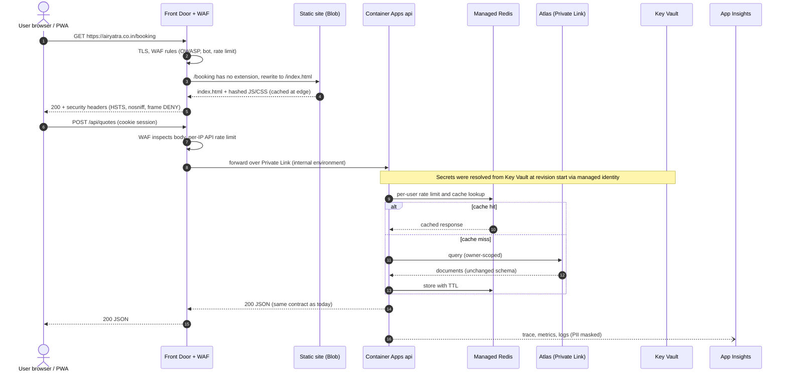
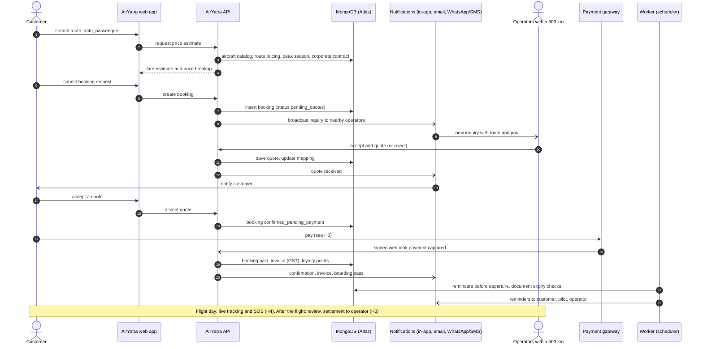
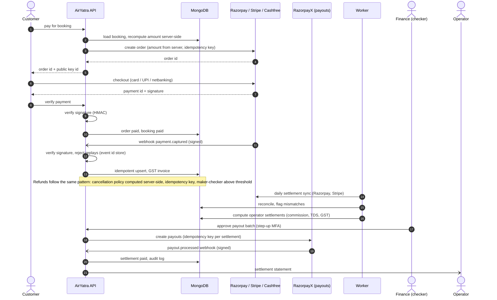
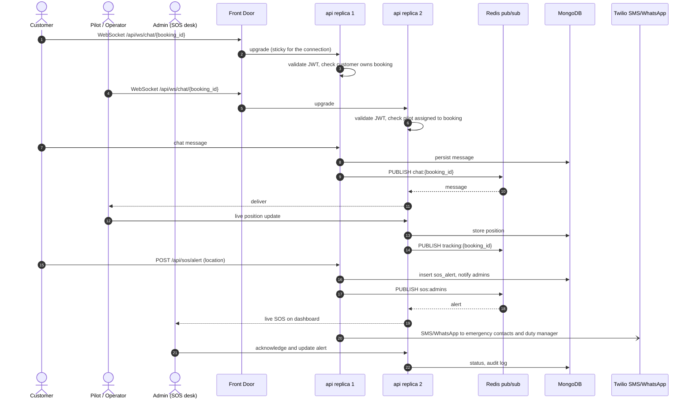
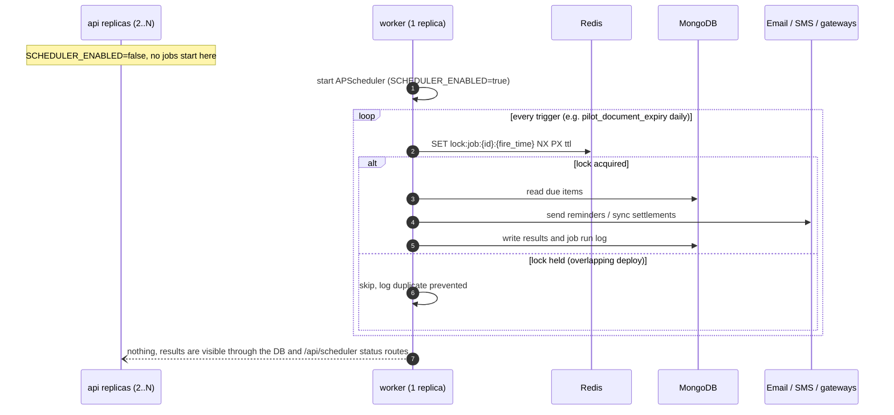
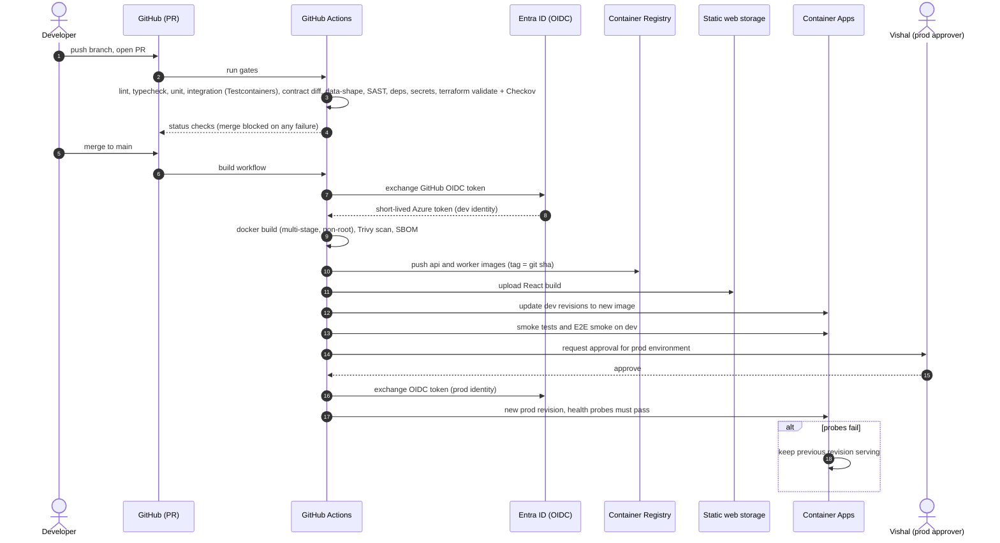
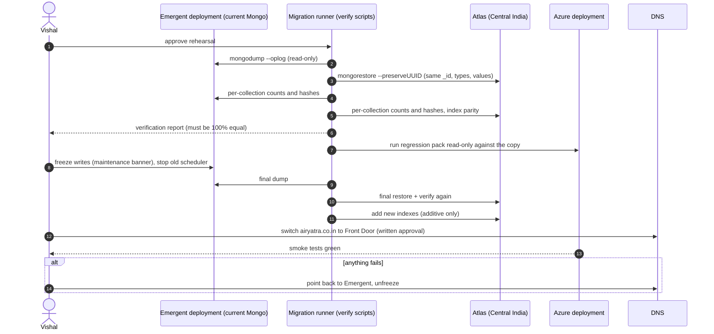
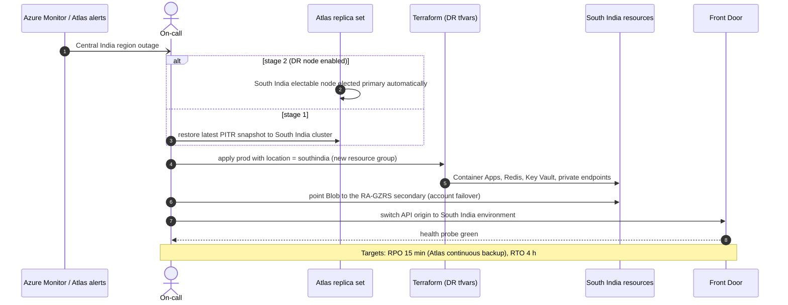

# High-Level Sequence Diagrams

How the major parts of AirYatra talk to each other on Azure. Each diagram shows systems, not functions; the
[low-level diagrams](03-sequence-diagrams-low-level.md) zoom into the code paths. Components match
[01-target-architecture.md](01-target-architecture.md) and [`infra/terraform`](../../infra/terraform/README.md).

| # | Flow | Why it matters |
|---|---|---|
| H1 | [Request path through the platform](#h1-request-path-through-the-platform) | Every page load and API call |
| H2 | [Booking lifecycle, end to end](#h2-booking-lifecycle-end-to-end) | Core revenue journey (Q.2 items 2 and 3) |
| H3 | [Payment and settlement money flow](#h3-payment-and-settlement-money-flow) | Payments, invoices, payouts (Q.2 items 2, 4, 6) |
| H4 | [Real-time: chat, live tracking and SOS](#h4-real-time-chat-live-tracking-and-sos) | WebSockets across replicas (Q.2 item 8) |
| H5 | [Background jobs run exactly once](#h5-background-jobs-run-exactly-once) | Scheduler in the worker (Q.2 item 10) |
| H6 | [Build and deploy (CI/CD)](#h6-build-and-deploy-cicd) | How code reaches prod |
| H7 | [Data migration and cutover](#h7-data-migration-and-cutover) | Phase 2, zero data change |
| H8 | [Regional disaster recovery](#h8-regional-disaster-recovery) | RPO 15 min / RTO 4 h |

---

## H1. Request path through the platform

## H2. Booking lifecycle, end to end

## H3. Payment and settlement money flow

## H4. Real-time: chat, live tracking and SOS

## H5. Background jobs run exactly once

## H6. Build and deploy (CI/CD)

## H7. Data migration and cutover

## H8. Regional disaster recovery

