# Low-Level Sequence Diagrams

Code-level flows inside the AirYatra API on Azure. Participants are classes and modules. Where the code
does not yet have the class named here, the participant is the **target class from Section E** (Router → Service →
Repository / Adapter) and the note under the diagram names today's file and line, so Phase 3 refactors have a map.
Every diagram keeps the API path, request and response unchanged (Constraint 4) and the stored document shape
unchanged (Constraint 1).

`[gap]` marks a behaviour that differs from today and is fixed in Phase 3 under Section S; the Phase 0
[security audit](../phase0/SECURITY_AUDIT.md) has the evidence.

| # | Flow | Q.2 journey |
|---|---|---|
| L1 | [Password login: lockout, Login Shield, OTP/TOTP, tokens](#l1-password-login) | 1 |
| L2 | [Google sign-in without Emergent](#l2-google-sign-in-without-emergent) | 1 |
| L3 | [Create booking and broadcast inquiry](#l3-create-booking-and-broadcast-inquiry) | 2, 3 |
| L4 | [Operator quote and customer acceptance](#l4-operator-quote-and-customer-acceptance) | 3 |
| L5 | [Razorpay order, verification and webhook](#l5-razorpay-order-verification-and-webhook) | 2 |
| L6 | [Cancellation and refund](#l6-cancellation-and-refund) | 4 |
| L7 | [KYC upload and download](#l7-kyc-upload-and-download) | 5 |
| L8 | [Operator settlement and RazorpayX payout](#l8-operator-settlement-and-razorpayx-payout) | 6 |
| L9 | [Village landing permission, multi-level approval](#l9-village-landing-permission) | 7 |
| L10 | [SOS alert](#l10-sos-alert) | 8 |
| L11 | [Authorisation on every request](#l11-authorisation-on-every-request) | 9 |
| L12 | [Scheduler job in the worker](#l12-scheduler-job-in-the-worker) | 10 |
| L13 | [WebSocket chat across replicas](#l13-websocket-chat-across-replicas) | — |
| L14 | [AI chatbot through Azure OpenAI](#l14-ai-chatbot-through-azure-openai) | — |
| L15 | [Container start-up and health](#l15-container-start-up-and-health) | — |

---

## L1. Password login

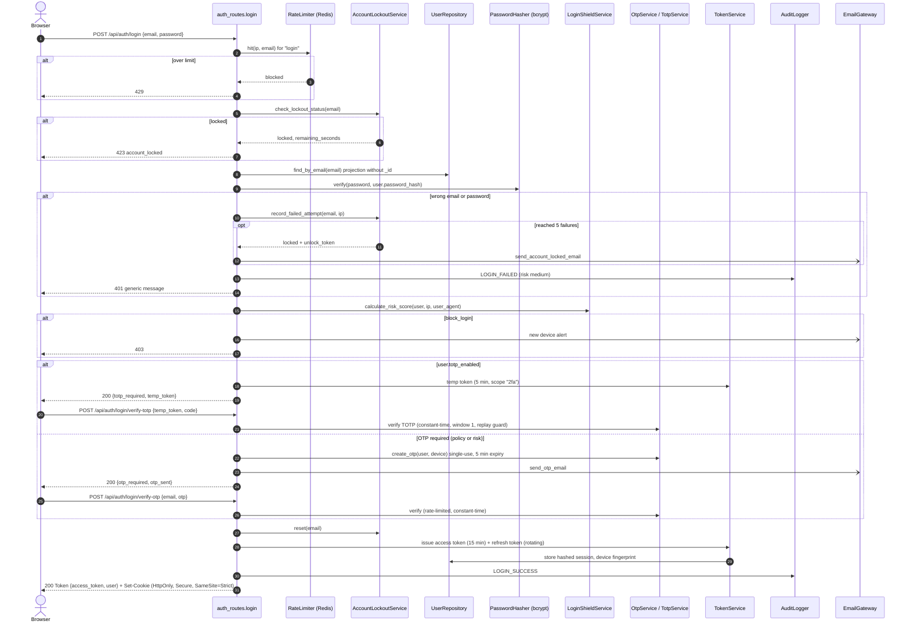

Today: `backend/routes/auth_routes.py:159` (login), `:417` (verify-otp), `:555` (verify-totp); token from
`backend/auth.py:18`. `[gap]` Access token lifetime defaults to 7 days (`ACCESS_TOKEN_EXPIRE_MINUTES=10080`,
`backend/config.py`); target 15 minutes plus a refresh token. `[gap]` The body still returns `access_token` so
existing clients keep working; the cookie is added alongside and the front end moves to it in Phase 3.
`[gap]` Lockout counters move from MongoDB/in-memory to Redis so every replica sees the same count.

## L2. Google sign-in without Emergent

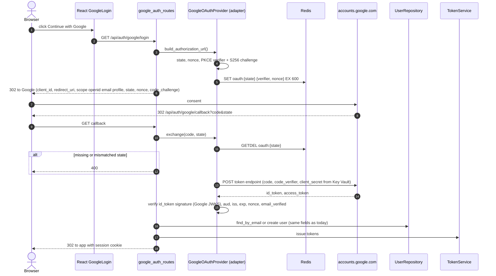

Today: `backend/routes/google_auth_routes.py:46` (`/login`), `:80` (`/callback`) and the Emergent path
`/google/emergent-callback` (`google_auth_routes.py:498`, `auth_routes.py:1610`). The Emergent routes stay
mounted and return the same shape during the transition, then are retired once no client calls them.

## L3. Create booking and broadcast inquiry

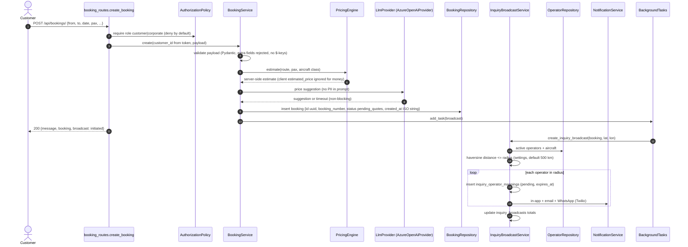

Today: `backend/routes/booking_routes.py:15` takes `booking_data: dict` and stores
`estimated_price` from the client; `backend/services/inquiry_broadcast_service.py:148`.
`[gap]` A typed request model replaces `dict` with the **same field names** so stored documents do not change.
Booking `created_at` stays an ISO string (today's format, see the Phase 0 data dictionary).

## L4. Operator quote and customer acceptance

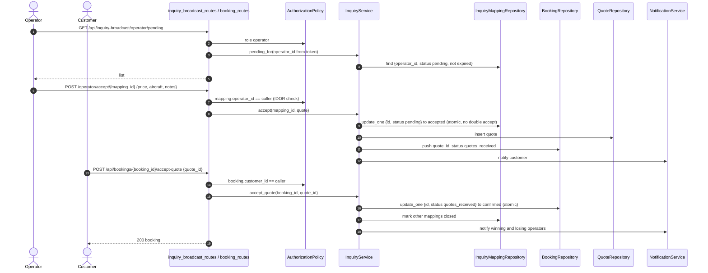

Today: `backend/routes/inquiry_broadcast_routes.py:122`, `backend/services/inquiry_broadcast_service.py:446`,
`backend/routes/booking_routes.py:376`.

## L5. Razorpay order, verification and webhook

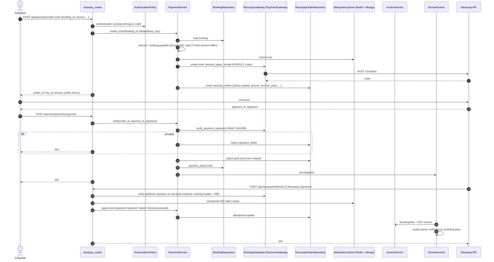

Today: `backend/routes/razorpay_routes.py:68` (create-order), `:149` (verify), `:241` (webhook).
`[gap]` create-order has no authentication and trusts the client `amount` (`razorpay_routes.py:68-80`).
`[gap]` The webhook skips the signature check when the header or secret is missing
(`if RAZORPAY_WEBHOOK_SECRET and signature:`). `[gap]` No idempotency or replay store.
Stored fields in `razorpay_orders` and `bookings` are unchanged by these fixes.

## L6. Cancellation and refund

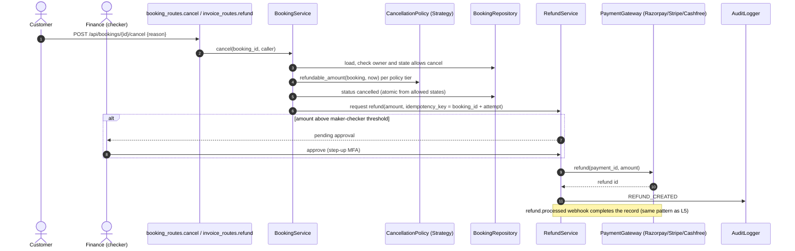

Today: `backend/routes/booking_routes.py:413`, `backend/routes/invoice_routes.py:302`,
`backend/routes/razorpay_routes.py:433`; cancellation fee tiers are published in `backend/routes/legal_routes.py:303` (20% / 30% / 50% by hours before departure) and configured through `backend/routes/pricing_engine_routes.py` and the admin `CancellationPolicyTab`.

## L7. KYC upload and download

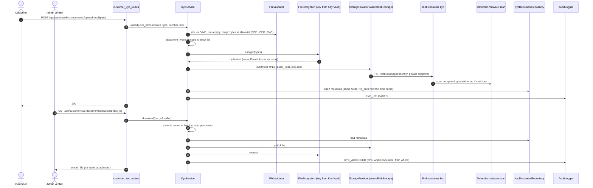

Today: `backend/routes/customer_kyc_routes.py:90` (upload), `:267` (download), encryption in
`backend/security_middleware.py:412`. Files are written to local disk today; `secure_uploads/kyc/*.enc` is also
committed to git (Phase 0 audit). Encrypted KYC files are streamed through the API rather than given a SAS URL,
because they must be decrypted server-side. Non-sensitive files (village documents, aircraft photos) use a
5-minute user-delegation SAS URL instead.
`ASSUMPTION` Existing `file_path` values stay as stored; the storage adapter maps an old local path to its blob name
so no document is rewritten.

## L8. Operator settlement and RazorpayX payout

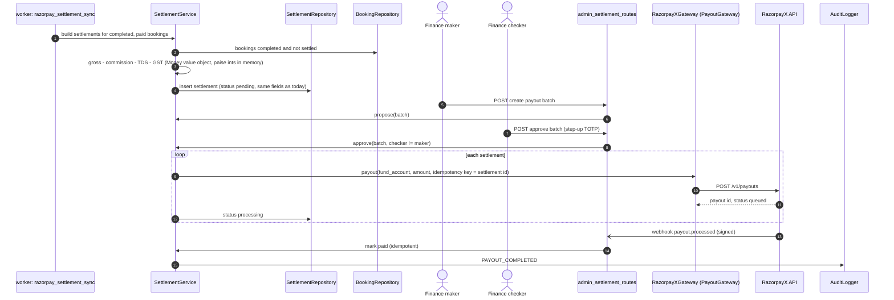

Today: `backend/services/settlement_service.py`, `backend/routes/settlement_automation_routes.py`,
`backend/routes/admin_settlement_routes.py`, scheduler job `razorpay_settlement_sync` in `backend/scheduler.py`.
`[gap]` Maker-checker and step-up MFA for payouts are new controls (S.3).

## L9. Village landing permission

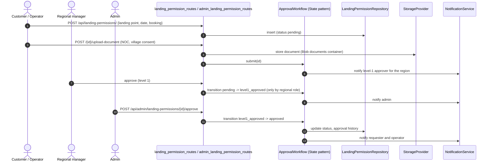

Today: `backend/routes/landing_permission_routes.py:12`, `:46`, `backend/routes/admin_landing_permission_routes.py:43`,
`backend/services/approval_workflow.py`.

## L10. SOS alert

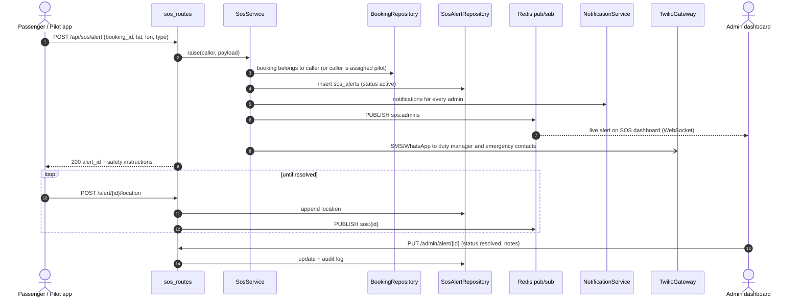

Today: `backend/routes/sos_routes.py:36` (alert, inserts `sos_alerts` and per-admin `notifications`), `:121`, `:265`.
`[gap]` Admin fan-out is in-app only today; SMS/WhatsApp escalation and the live pub/sub push are added.

## L11. Authorisation on every request

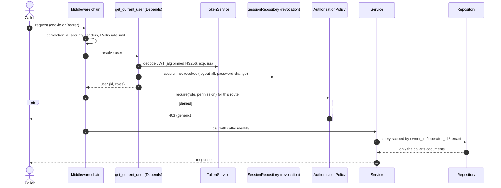

Today: `get_current_user` in `backend/routes/auth_routes.py` and role checks spread across route modules.
Negative tests per role are part of the Phase 3 test pack (Q.2 item 9).

## L12. Scheduler job in the worker

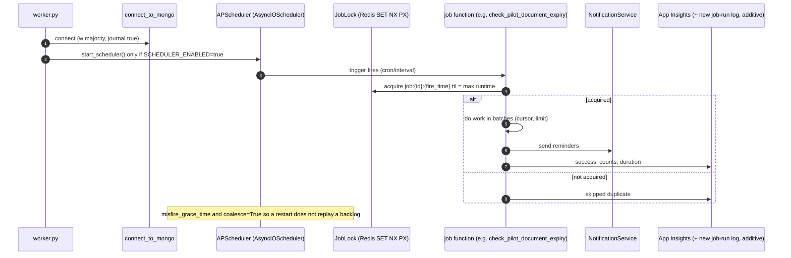

Today: `backend/scheduler.py` (16 `add_job` calls) started from `server.py` startup in every API process.
`[gap]` `worker.py` entry point and `SCHEDULER_ENABLED` flag are added in Phase 3; the API stops starting the scheduler.

## L13. WebSocket chat across replicas

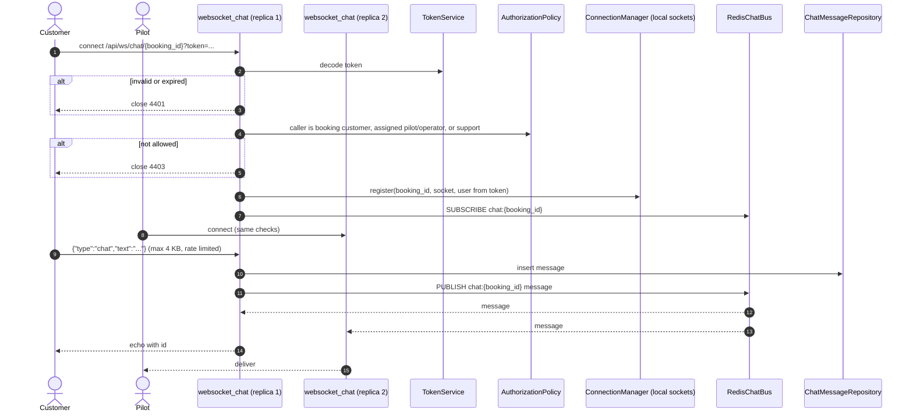

Today: `backend/routes/websocket_chat_routes.py:65`. `[gap]` The token query parameter is read but not
verified; `name`, `type` and `user_id` are taken from the query string. `[gap]` `ConnectionManager` is in process
memory, so users on different replicas cannot see each other until the Redis bus is added.

## L14. AI chatbot through Azure OpenAI

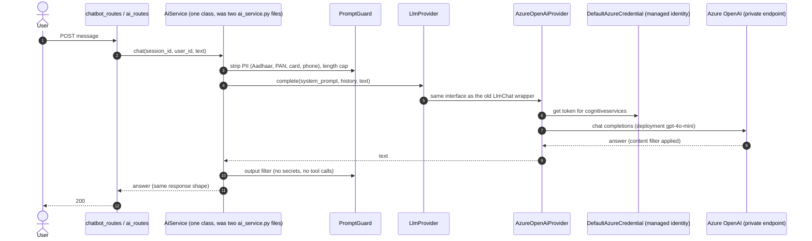

Today: `backend/services/ai_service.py` and `backend/ai_service.py` both wrap `emergentintegrations.llm.chat.LlmChat`
with `EMERGENT_LLM_KEY` and a hard-coded fallback key (Phase 0 audit, Critical).

## L15. Container start-up and health

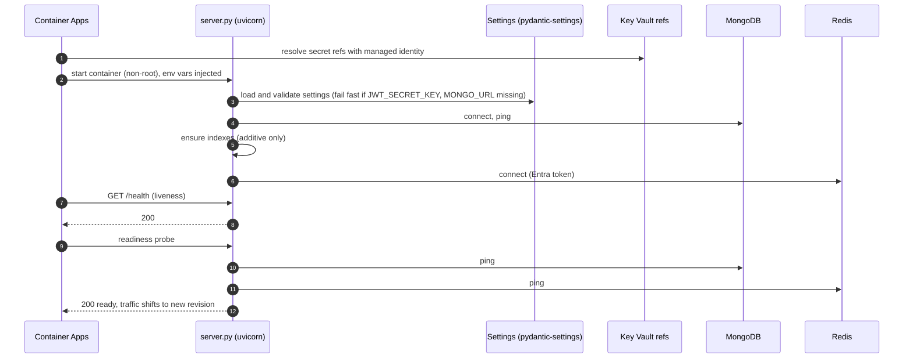
